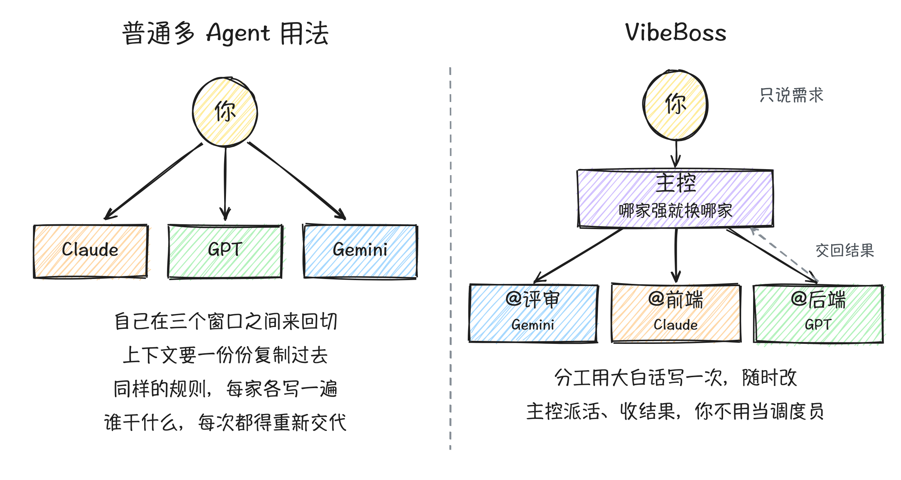
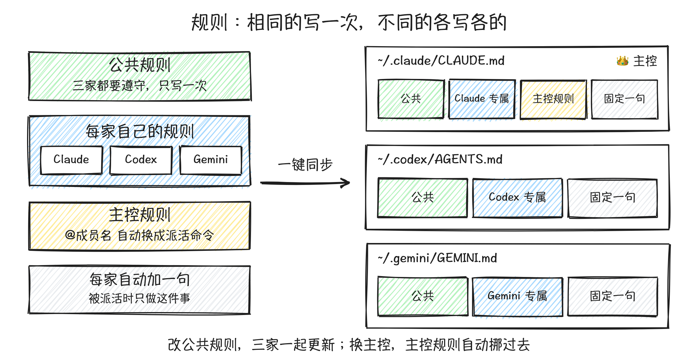
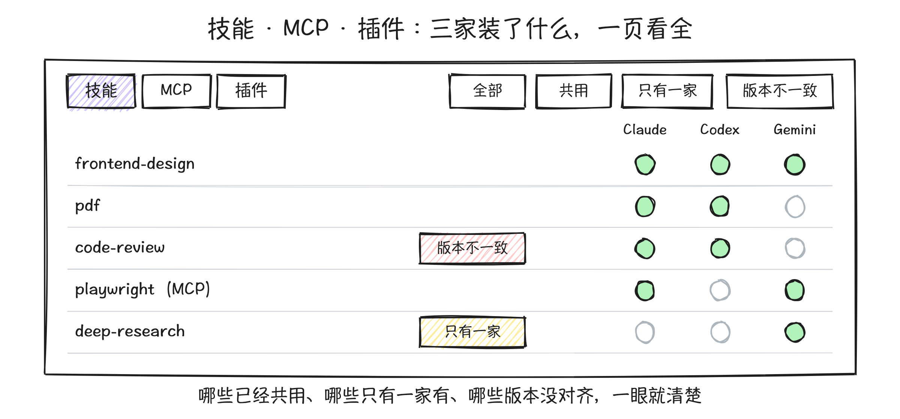

<p align="center">
  
</p>

<h1 align="center">VibeBoss</h1>

<p align="center">面向产品经理等非研发人员的 AI Agent 桌面应用。<br>你只跟一个主控说需求，它按你定的分工，调动 GPT、Claude、Gemini 三家一起把活干完。</p>

<p align="center">
  <a href="#开始使用"><b>开始使用</b></a> ·
  <a href="#能做什么">功能</a> ·
  <a href="#为什么适合产品经理">为什么适合产品经理</a> ·
  <a href="#隐私与账号">隐私与账号</a> ·
  <a href="#开源与致谢">开源与致谢</a>
</p>

<p align="center">
  
  
  <a href="LICENSE"></a>
</p>

## 能做什么

|                                  |                                                                                                                                               |
| -------------------------------- | --------------------------------------------------------------------------------------------------------------------------------------------- |
| 🧭 **一个主控，带一支团队**      | 你只面对主控。拆任务、派给谁、收结果都由它按分工完成，不用在几个 Agent 之间来回切换、复制上下文。                                             |
| 🤝 **三家模型各用所长**          | Codex（GPT）、Claude Code（Claude）、Antigravity（Gemini）同在一个窗口。比如 Claude 统筹和写前端、GPT 写后端、Gemini 做评审，怎么分你说了算。 |
| 👑 **主控随时换**                | 哪天哪家模型特别强，在“分工”页把主控换成它，规则自动跟着重写。                                                                                |
| ✍️ **分工用大白话写**            | 用自然语言写清楚“什么活交给谁、怎么验收”，也可以让 Agent 帮你写。不用搭固定死板的工作流，想调整随时改。                                       |
| 📜 **规则统一维护**              | 三家相同的规则写成一份公共规则，每家只写自己不同的部分；主控规则只给主控，一键同步，改之前自动备份。                                          |
| 🧩 **技能、MCP、插件合在一起看** | 三家装的技能、MCP、插件列在同一页，标明哪些共用、哪些只有一家有、哪些版本不一致。                                                             |
| 📊 **用量一眼看**                | 各家的剩余额度集中显示，Antigravity 的登录过期后会自动续上。                                                                                  |

## 为什么适合产品经理

产品经理本来就是这样工作的：讲清需求，交给合适的人，最后验收结果。VibeBoss 把这套方式搬到了 AI 身上。

- **你只当老板**：只跟主控提需求、看结果，不用学命令行，也不用记每家的参数。
- **分工就像写 PRD**：用大白话写清谁负责什么、怎么验收，不用画流程图，也不用搭 workflow。
- **团队随时重组**：哪家模型最近最强，就让它当主控；成员换了模型，分工不用改。
- **界面只留用得上的**：中文界面，只保留三家 Agent，开发者才用的设置都收起来了。

## 和普通多 Agent 工具比，好在哪

<p align="center"></p>

|                   | 普通多 Agent 客户端（如 T3 Code 原版）        | VibeBoss                                   |
| ----------------- | --------------------------------------------- | ------------------------------------------ |
| 谁来调度          | 你在几个 Agent 之间切换，或者每次交代谁做什么 | 主控按分工派活、收结果，你只说需求         |
| 分工              | 每次重新说一遍，或者写死成固定的 workflow     | 大白话写一次，想改随时改，同步就生效       |
| 换模型            | 规则和流程里写死的地方都得改                  | 一键换主控；成员换模型，`@名字` 自动跟着变 |
| 规则              | 三家的规则文件各写一遍，容易对不上            | 公共规则写一次，每家只写自己不同的部分     |
| 技能 / MCP / 插件 | 去三家的目录里各翻各的                        | 一页看全：共用的、独有的、版本不一致的     |
| 界面              | 面向开发者，设置项很多                        | 中文，只留三家，开发者设置收起来           |

### 多出来的这套协作，好在哪

在“分工”页设一个**主控**和几位**成员**。每位成员有自己的名字、背后的 Agent、模型、思考档位和备注。

- **三家各用所长**：规划、写代码、评审交给最擅长的那一家，而不是让一个模型包揽所有事。换一家模型来评审，也更容易发现同一个模型自己看不出的问题。
- **你不用当调度员**：主控负责拆任务、整理上下文交给成员，再把结果收回来汇总，你不用在几个窗口之间来回复制粘贴。
- **不被一家绑住**：大模型更新很快，哪家变强了，把主控换成它就行，规则会自动重写。
- **换人不用改规则**：规则里用 `@成员名` 指代成员。成员背后换了 Agent 或模型，`@成员名` 自动指向新的那一家。
- **不会层层转包**：每位成员都会收到“被派活时只做这件事，不再往下派”。

分工直接用大白话写，例如：

> 大方案先交给 @评审 看，只给它用户原话和必要背景；前端交给 @前端，成块的后端交给 @后端，接口和验收标准由你来定。

写不好也没关系，把想法告诉 Agent，让它替你写一版。

### 公共规则，好在哪

<p align="center"></p>

- **改一次，三家同时生效**：不会出现“Claude 记得用中文汇报，Codex 却忘了”这种对不上的情况。
- **差异一目了然**：每家页面只放它自己独有的部分，三家哪里不一样，一眼就能看出来。
- **主控规则只给主控**：成员不会误以为自己也要派活；换了主控，主控规则自动跟过去。
- **放心覆盖**：每份文件都标明是否已同步，第一次写入前自动备份原文件。

### 技能、MCP、插件合在一起看

<p align="center"></p>

三家各自装的技能、MCP 服务和插件，合在一个页面里，每一项都标明哪几家在用。可以按“共用”“只有一家”“版本不一致”筛选，哪些已经共享、哪些需要补装、哪些要对齐版本，一眼就清楚。

<details>
<summary>其他功能</summary>

| 功能           | 说明                                                            |
| -------------- | --------------------------------------------------------------- |
| 一键登录       | Claude 显示“未认证”时，直接在设置页里登录，不用自己开终端       |
| 会话按项目整理 | 可以拆成“项目 / 会话”双栏；会话能放进自建分区，分区也能整个置顶 |
| 上下文用量     | 会话详情里能看到上下文用了多少，可以一键压缩                    |
| 更少的干扰     | 只保留这三家 Agent，开发者才用得到的设置都收起来了              |
| 中文界面       | 默认中文                                                        |

</details>

## 开始使用

1. **安装**：到 [Releases 下载页](https://github.com/AKin-lvyifang/vibeboss/releases/latest) 下载。Mac（苹果芯片）用 `.dmg`，Windows 用 `.exe`。
   - 安装包没有做苹果和微软的签名，第一次打开会被拦一下：
   - Mac 提示“已损坏”或“无法验证开发者”：把 VibeBoss 拖进“应用程序”后，在终端运行 `xattr -dr com.apple.quarantine /Applications/VibeBoss.app`，再打开。
   - Windows 提示“Windows 已保护你的电脑”：点“更多信息”，再点“仍要运行”。
2. **登录 Agent**：在设置里分别登录 Claude、Codex、Antigravity，用的都是你自己的账号。
3. **设分工**：在“分工”页选好主控、加几位成员；在“规则”页写好公共规则和分工，点“同步”。
4. **开始用**：新建会话，直接跟主控说你要做什么。

## 隐私与账号

- **自己登录，自己的额度**：每个人登录自己的账号、用自己的额度。VibeBoss 不内置任何账号、令牌或中转网关。
- **数据留在本机**：会话和配置保存在你的电脑上，不接任何云服务；对话内容只发给你登录的那家模型服务。
- **不做遥测**：使用统计默认关闭。
- **会改动的本机文件**：只有点“同步”时，才会写入三家的全局规则文件，写入前先备份。

## 使用须知

- **安装包暂未签名**，第一次打开会有安全提示：
  - **Mac**：第一次打开被拦下后，到“系统设置 → 隐私与安全性”点“仍要打开”。如果提示“已损坏”，在终端运行 `xattr -cr /Applications/VibeBoss.app`。
  - **Windows**：提示“已保护你的电脑”时，点“更多信息 → 仍要运行”。
- **需要先装好 Agent**：Claude Code 和 Codex 的命令行工具要先装在本机；Antigravity 由 VibeBoss 自动下载。

<details>
<summary>自己打包</summary>

需要 Node 26 和 [Vite+](https://viteplus.dev)（`vp`）。

```bash
vp install
# Mac（苹果芯片）
VIBEBOSS_SKIP_APPLE_SPEECH=true node scripts/build-desktop-artifact.ts --platform mac --target dmg --arch arm64
```

Windows 安装包在 GitHub Actions 的 “VibeBoss Windows” 流程里打。每一轮改动的范围和原因，记在 [docs/更新](docs/更新/2026-11-24-VibeBoss-M1魔改范围.md)。

</details>

## 开源与致谢

VibeBoss 按 [MIT 许可](LICENSE)开源。

VibeBoss 基于 [T3 Code](https://github.com/pingdotgg/t3code)（MIT）开发，并持续合并它的更新。感谢 T3 团队把这么好的多 Agent 底座开源出来，许可证里保留了 T3 Code 原作者的版权声明。
